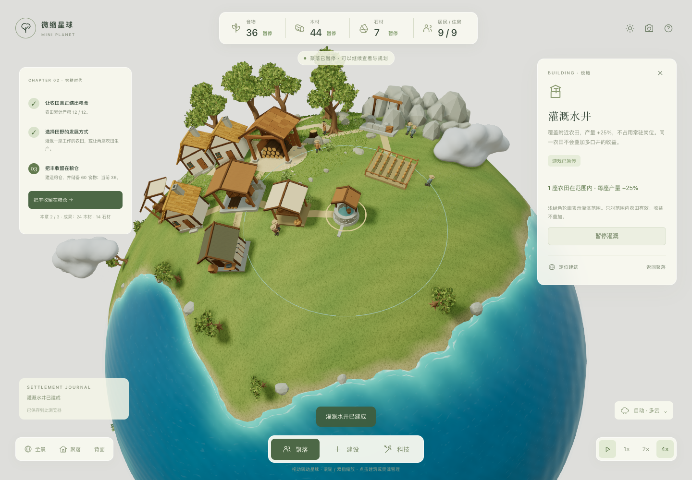

# 微缩星球 · 文明初生

在完整、可自由转动的 3D 星球上，从六人的林间聚落发展到农耕、冶炼和第一套机械动力。当前可玩版本为 0.2，长期文明主线为采集 → 农耕 → 工业 → 信息 → 人工智能 → 星际。



## 开始玩

打开 `output/planet-demo/planet-demo.html` 即可离线游玩。需要支持 WebGL 2 的现代浏览器。

四个连续章节引导发展：

1. **林间安家**：建设住宅、维持食物、发展人口，选择第一项研究。
2. **田野丰收**：农田真正产粮，选择灌溉或扩田，建设粮仓储备食物。
3. **炉火初燃**：开采矿石，用木材作燃料冶炼金属。
4. **机械初鸣**：锻造工具、研究机械、制造并投入 8 个机械零件，进入工业起步。

完成章节后点击目标按钮领取成果。后续信息、智能和星际时代列入开发清单，当前版本不提供这些阶段的可玩系统。

拖动转动星球，滚轮 / 双指缩放，可以一直拉近到地面附近查看模型细节。点击建筑管理人手；从「建设」选设施，在球面确认选址，R 旋转、Esc 取消。水井预览显示灌溉范围。顶部资源可以点击，查看生产来源、满负荷需求和缺料原因。加工设施可设置目标库存，达到目标后停止耗料，库存下降后继续。

暂停和 1× / 2× / 4× 控制全部经济活动。天气和海水保持独立的视觉变化，暂不改变产量。帮助菜单提供光照之外的观察选项，以及存档导出、导入、撤销上次导入和重新开始。

## 这一版加入了什么

- 灌溉水井、粮仓、矿场、冶炼炉、锻造工坊、机械工坊及对应 3D 表现。
- 矿石、金属、金属工具、机械零件；原料不足停工，完成一轮时扣料，目标库存避免无目的消耗。
- 四个能力章节与一次性成果；农耕需要真实收获，工业起步需要实际零件投入。
- 研究结束释放人手，资源来源与消耗可查询、可定位。
- 食物基础容量 80，粮仓增加 160；灌溉提高附近农田产量 25%，同田不叠加。
- v1 存档兼容、v2 累计生产记录、JSON 导入导出及撤销导入。

### 画面、模型与测试模式

- 水面按像素计算水深：浅滩透出沙底和焦散，近岸有碎浪泡沫，深海渐变更柔和；海滩、湿沙和草地斑块同样按像素过渡。
- 建筑改用统一的模型工具：程序生成的灰泥、砖石、茅草、瓦片、波纹钢和幕墙纹理，圆角体块、木构架、门窗、烟囱冒烟、炉火与机械动画。
- 按发展计划补齐六个时代的建筑模型，其中 22 种后续时代建筑是「概念模型」，只用于展示外观。
- 树冠加入内部体积和明暗层次，远景树合并为实例；山地增加针叶林，岩石改为带苔藓的风化巨石。开局场景树木翻倍，三角面减少一半以上，绘制次数减少约三成。
- 流畅度与精度：地形与水深在启动时烘焙成贴图，阴影只在星球转动或物体移动时刷新，环境光遮蔽以半分辨率计算；高分屏最高按 2 倍像素渲染，阴影范围跟随镜头收紧，近景阴影更清晰，建筑纹理密度提高一倍，圆形部件按尺寸加密。帧率不足时自动逐级降低分辨率和特效。
- **测试模式**：打开 `planet-demo.html?test`，或在帮助菜单点「进入测试模式」。在独立的测试星球上，全部建筑免费且立即建成；可以按时代建造、一键建造全部、近景查看、移除或清空。测试进度单独保存，不影响正式聚落。

详见 [游玩指南](docs/gameplay-guide.md) 和 [验证记录](docs/demo-validation.md)。当前继续使用共享库存和局部作业动画；真实运输、资源枯竭、建筑升级、能源和后续时代按依赖推进。

## 策划知识库与持续迭代

[知识库入口](docs/knowledge/README.md)整理了 12 款参考游戏、13 个官方来源，包含机制卡、经济模型、时代设计与试玩方法。来源事实、本项目推断和验证结果分开记录。

[开发清单](docs/development/backlog.md)包含优先级、依赖、验收条件和状态；[迭代记录](docs/development/iterations.md)保存每轮结果和下一步。开发按“体验问题 → 设计假设 → 最短实现 → 规则与浏览器验证 → 修订”推进。

## 开发与验证

```bash
npm ci
npm run dev
```

稳定试玩入口为 `http://localhost:5186`，开发默认 `http://localhost:5187`。在 Agent Tower 中使用工作区服务管理长驻服务器。稳定入口仅在新版本通过检查后更新，已有网址的存档继续保留。

```bash
npm test
npm run balance
npm run build
npm run package:demo
python3 scripts/package-knowledge.py
python3 scripts/package-source.py
# 确认本轮规则、UI 与画面检查通过后，再更新稳定试玩：
npm run stage:stable
```

可选的实际 UI 回归需要安装 `agent-browser`，并已有运行中的工作区服务：

```bash
npm run qa:gameplay -- --fresh
```

它使用独立浏览器，通过实际按钮、4× 游戏速度和只读状态检查走通四章；不直接推进模拟时间或添加资源。完成后关闭测试浏览器，`--keep-browser` 可用于继续检查。

`dist/` 为预构建站点，`output/planet-demo/planet-demo.html` 为独立离线文件，`output/planet-demo.zip` 包含源码和完整说明，`output/planet-planning.zip` 为知识库与开发记录包。历史 `woodland-demo`、`planet-weather` 离线路径同步更新。

## 存档与范围

进度自动保存在当前浏览器，约每 10 秒、每次操作及离开页面时写入。切到后台暂停推进，关闭后不计算离线收益。不同浏览器、网址和文件路径可能使用独立存储；可以用 JSON 导出迁移。

旧版存档保留资源、建筑、居民和未完成任务；新增材料与累计生产从迁移后记录，章节从新目标开始。超出新食物容量的原有储备保留。导入先验证，失败不覆盖当前游戏；有效导入会留下可在帮助菜单撤销的备份。

当前为单星球文明的前期发展。玩家试玩反馈仍用于判断节奏和选择是否有趣；自动测试和脚本完成不等同于证明玩家体验。

## 来源与许可

几何、纹理生成、人物、布局和交互为本项目制作，沿用已确定的微缩星球与植被美术方向。Three.js 使用 MIT 许可；Noto Serif SC 字形子集使用 SIL Open Font License 1.1，见 `public/fonts/OFL.txt`。离线文件附带相关许可。知识库引用来源链接和原创机制摘要，不打包第三方游戏资产或页面全文。
