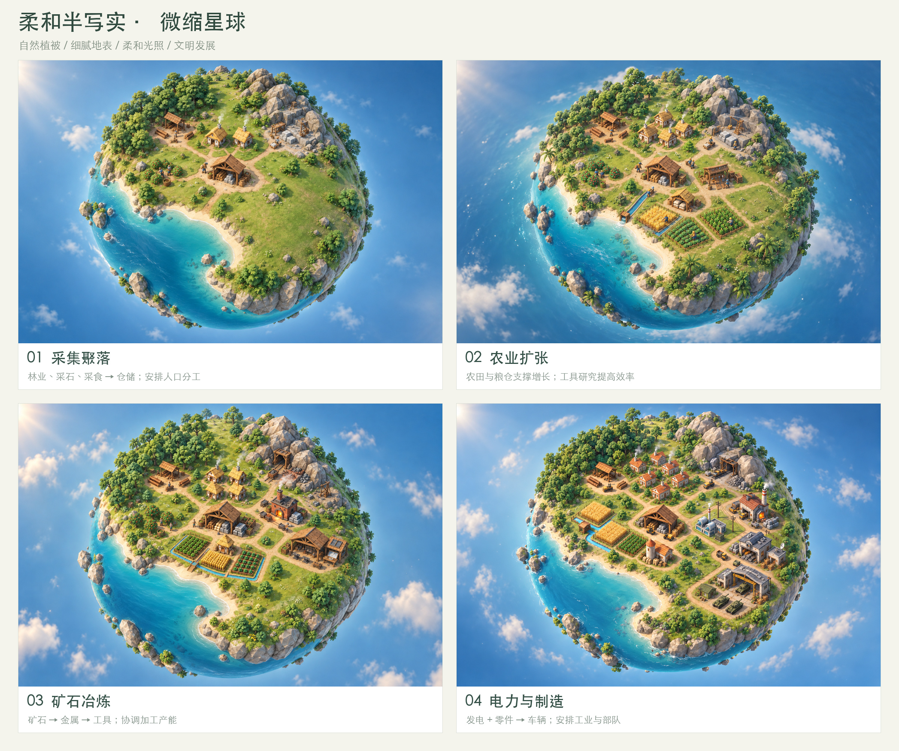

# 迷你星球文明：设计文档

更新：2026-10-19 · 主设计与迭代资料持续维护

从[策划知识库](knowledge/README.md)查看机制依据，从[开发清单](development/backlog.md)查看优先级与状态，从[迭代记录](development/iterations.md)查看具体结果。当前玩法说明见[游玩指南](gameplay-guide.md)，交付检查见[验证记录](demo-validation.md)。

本项目以“管理整颗迷你星球，逐步发展文明”为核心。玩家安排建设、人口、科技与生产，居民和单位自动执行。当前已确定采用柔和半写实的风格化 3D 微缩沙盘美术。

## 阅读顺序

| 文档 | 内容 |
| --- | --- |
| [策划知识库](knowledge/README.md) | 12 款游戏的来源、机制卡、经济模型与试玩方法 |
| [开发清单](development/backlog.md) | 当前三轮和后续六时代任务，含依赖与验收条件 |
| [迭代记录](development/iterations.md) | 实现、验证、平衡和后续问题 |
| [游戏设计](mini-planet-design.md) | 核心循环、文明演进、资源规则、原型范围与远期边界 |
| [玩家操作与界面](player-interactions.md) | 点击什么、调整什么、自动执行什么，以及异常如何反馈 |
| [建造游戏调研与交互讨论](building-games-research.md) | 五款参考游戏的逻辑、球面建造建议与待讨论取舍 |
| [美术与图片规范](planet-art-direction.md) | 已确定风格、四阶段图片、界面图与水体表现原则 |
| [树木与林地修订](vegetation-design.md) | 单棵树、林地间距、采伐可读性与场景试放 |
| [采集聚落与多视角](gathering-settlement.md) | 首个可玩状态的设施清单、布局关系、镜头约定与多视角图 |

## 当前基准

- **定位已确定：** 星球管理、资源生产、科技演进和可见的文明成长。
- **美术已确定：** 自然植被、细腻地表、柔和光照、微缩建筑与简洁透明界面。
- **植被修订中：** 简化树冠颗粒、露出树干、成组留空，并先比较单棵树和林地造型。
- **起步场景：** 采集聚落，包含储物点、两座住宅、伐木点、采石场和采食区。
- **当前推荐交互：** 玩家摆放设施、设置岗位优先级、选择研究和安排生产；居民自动工作。
- **需要验证：** 数值、岗位调配细则、科技条件、发展节奏、军事比重和目标平台。
- **远期边界：** 联网、星际与舰队按开发清单独立推进，当前可玩范围以迭代记录为准。

## 图片入口

[采集聚落场景](assets/approved-style/01-gathering.png) · [管理界面总览](assets/approved-style/management-comparison.jpg) · [采集聚落多视角](assets/gathering-views/comparison.jpg)

已选定的图片集中存放在 `docs/assets/`，文档使用相对路径关联，整份目录复制或下载后可继续阅读。早期探索图片保留在工作区的 `output/` 中，当前规范以本目录的基准图和设施清单为准。

概念图用于统一美术、空间关系与交互意图；图片中的人口、库存和队列数值不代表最终平衡，也不代表相应功能已完成开发。
