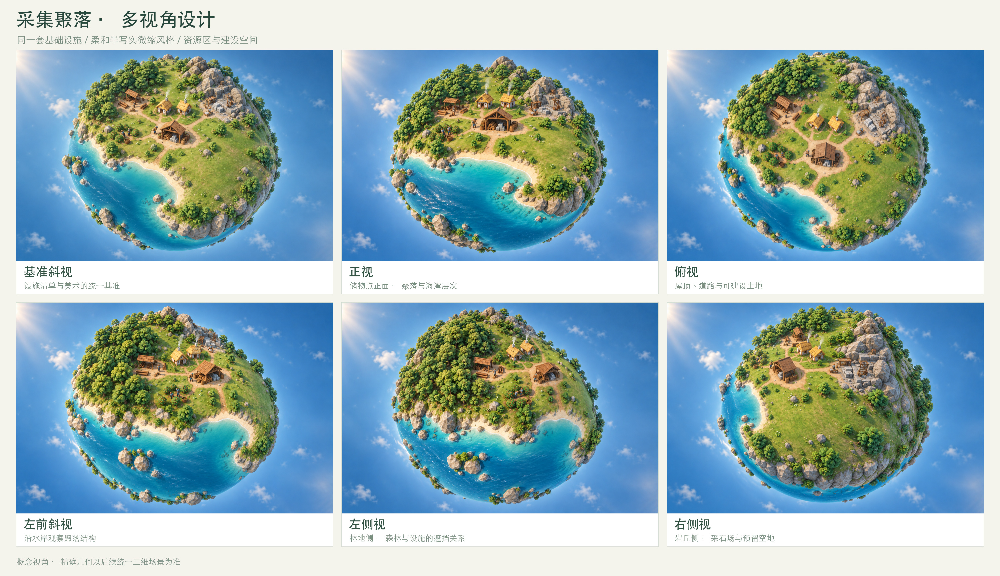

# 采集聚落基准与多视角

更新：2026-10-16 · 首个可玩状态与场景设计基准

[文档索引](README.md) · [游戏设计](mini-planet-design.md) · [玩家操作](player-interactions.md) · [美术规范](planet-art-direction.md)

## 基准图与使用方式

这张图确定采集聚落的美术、设施身份和主要空间关系。玩家管理一个已有基础设施的小聚落，先安排人口和生产，再扩建农业与工坊。

其中树木的冠层细节正在按[树木与林地修订](vegetation-design.md)调整，重点是可见树干、清楚轮廓和林间空隙；本页继续作为设施与地形布局的参照。

[场景原图](assets/approved-style/01-gathering.png) · [管理界面示意](assets/approved-style/01-gathering-annotated.png) · [设施与地形索引](assets/gathering-views/layout-index.jpg)

本节中的相对方向以基准图为参照，用于交流布局，不定义行星地理坐标或自转轴。人口数量、建筑容量、资源库存和产量属于后续数值设计。

## 固定设施与地形清单

| 编号 | 对象 | 本轮图示约束 | 功能与关系 |
| --- | --- | --- | --- |
| G01 | 中央储物点 | 一座开口木棚，能辨认木材、石块与食物容器 | 共享库存的视觉中心，连接各工作地点 |
| G02 | 住宅组 | 两座草顶住宅，集中在储物点后方 | 提供初始居住容量，形成聚落中心 |
| G03 | 伐木点 | 一处林缘作业棚、木料堆与工具 | 从左上方林地获得木材，经道路连接储物点 |
| G04 | 采石场 | 一处岩丘脚下的露天切石工地、石块与木制工作架 | 提供基础石材，保持与右上方岩丘的关联 |
| G05 | 采食区 | 一片低矮果灌木与采集篮 | 提供初始食物，位于林地和水岸之间 |
| G06 | 林地 | 基准图左上方的连续林地区域，树冠成组留空 | 作为木材资源区，保留林地边界与作业通道 |
| G07 | 岩丘 | 基准图右上方的岩石地形 | 提供石材区域，并为后续矿产发展留出可能 |
| G08 | 海湾与岸线 | 基准图左前方的连续海湾 | 形成固定水岸、地形轮廓与可建设区域的边界 |
| G09 | 待建设土地 | 储物点前方至右前方的开阔草地 | 为农田、住房和工坊扩展保留空间 |

两座住宅和各一处主要工作设施是本轮多视角的固定物件约束，不要求之后每局都采用完全相同的地图或建筑数量。

采集聚落中不放置农田、粮仓、金属工坊、冶炼炉、发电设施、车辆和军队。少量居民用于表现自动工作，没有可直接控制的主角。

## 空间与生产关系

中央储物点连接住宅、伐木点、采石场和采食区。道路应通向实际设施，资源区保留连续范围，避免把树木和房屋均匀散布在整个球面。

基准图可读作：

- 林地 → 伐木点 → 中央储物点。
- 岩丘 → 采石场 → 中央储物点。
- 果灌木 → 采食区 → 中央储物点。
- 住宅 → 可分配人口 → 工作岗位与建设任务。
- 待建设土地 → 后续农业、工坊与住宅扩展。

早期推荐共享库存。搬运和道路展示设施之间的工作关系，暂不以实际运输距离限制产量。

## 首个可玩状态

已有设施可以处于待分配岗位或低负荷运行状态，玩家的第一项有效操作是安排食物与材料工作的优先级。界面显示库存、净变化、人口去向和空缺岗位。

玩家随后预览扩建，选择农业或工具方向，并观察投入怎样改变资源缺口。初始库存需允许至少一种明确的后续发展选择，同时保留经营失误后的恢复途径。

推荐将基础工具工坊作为进入研究阶段的第一项建设：从开局列表可见，消耗木材与石材，完工后提供初级研究岗位。它属于下一步扩建，不出现在本轮采集聚落基准图中。

演示界面的“12 人”等数值只用于说明人口分工，不在本节设定最终初始人口、每户容量或每分钟产量。

## 多视角镜头约定

| 视图 | 原图 | 观察重点 |
| --- | --- | --- |
| 基准斜视 | [查看](assets/approved-style/01-gathering.png) | 整体风格、设施布局与主要地形关系 |
| 正视 | [查看](assets/gathering-views/01-front.png) | 从储物点入口一侧观察，核对建筑正面、聚落层次与海湾轮廓 |
| 俯视 | [查看](assets/gathering-views/02-top.png) | 从聚落上方观察屋顶、道路连接、资源区与待建设土地 |
| 左侧视 | [查看](assets/gathering-views/03-left.png) | 从林地一侧观察，检查森林、伐木点与聚落的遮挡关系 |
| 右侧视 | [查看](assets/gathering-views/04-right.png) | 从岩丘一侧观察，检查采石场、空地与聚落的空间层次 |
| 左前斜视 | [查看](assets/gathering-views/05-left-oblique.png) | 补充检查沿水岸旋转时的场景可读性 |

视角变化允许建筑被球面、树木或岩丘自然遮挡。不能为了让所有设施都可见而复制建筑、移动资源区或在背面新增聚落。

这些图片是生成式概念视图，镜头角度与表面细节未达到工程级配准。后续建模以已确定基准图、固定物件清单和布局关系为主要依据；未展示的背面地形尚未定稿，应在同一三维场景中统一后再验证各视角。

## 后续场景验收要点

1. 各方向观察时仍能认出同一组设施和地形地标。
2. 住宅与工作设施的数量、身份和原料表现一致。
3. 建筑沿当地球面向外站立，随视角产生合理透视和遮挡。
4. 伐木点贴近林地，采石场贴近岩丘，采食区提供独立食物来源。
5. 道路连接实际设施，储物点保持可理解的管理中心位置。
6. 保留用于下一阶段的建设空间，常用设施能被选中与定位。
7. 水面保持连续，岸线与地形相接，动效方案在引擎内另行验证。
8. 近景能看见生产活动，远景能读懂聚落状态。

本轮交付为文档与图片，不构成游戏实现或联网功能的开发确认。
