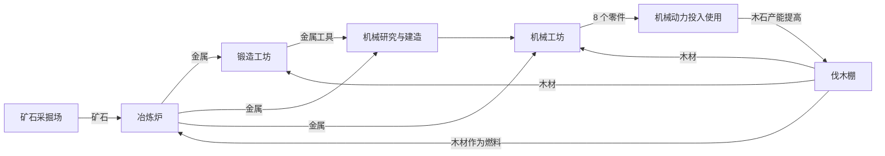

# 经济与文明进阶工作手册

## 经济建模

每个资源都登记来源、消耗、库存 / 容量、当前产能、解锁条件和后续用途。材料投入分两种：建设 / 研究先预留并逐步消耗；加工配方在完成一轮时原子扣除输入、增加输出。

理论产能 = 实际岗位 × 单轮产出 × 60 / 周期 × 效率。

预测净变化 = 当前可运行的生产 − 加工原料消耗 − 居民消费。预测必须标记“按当前岗位估算”；共享库存接近耗尽时，短周期竞争会导致实际产量变化。不能把理论最大值当作实际每秒到账。

检查清单：输入不足是否停工、多人竞争是否超额消耗、暂停是否继续扣料、取消是否重复退款、存档恢复是否重复完成一轮、旧资源是否仍有用途、产出满仓是否明确解释。

## 计划中的第一条加工链

矿场 → 矿石；矿石 + 木材 → 金属；金属 + 木材 → 金属工具；金属 + 木材 → 机械零件。

木材暂时承担燃料抽象，避免第一条链同时引入煤、焦炭、蒸汽和电网。工具和零件必须有研究 / 建设用途。所有配方数值都是本项目实验参数，不来自原作。

## 六个大时代

| 大时代 | 经营主题 | 代表能力 | 前一阶段成果的用途 |
| --- | --- | --- | --- |
| 采集 | 生存与分工 | 基础材料、住房、工坊 | 为耕作和扩张提供建设资源 |
| 农耕 | 土地效率与储备 | 农田、灌溉、粮仓 | 支撑脱离农业的工人和科研人员 |
| 工业 | 原料、加工、动力与运输 | 冶炼、工具、机械、发电 | 为电子制造提供材料与能源 |
| 信息 | 精密制造、通信、专业科研 | 芯片、通信网络、研究设施 | 为算力和自动化提供基础 |
| 人工智能 | 算力、能源与机器人分配 | 数据中心、自治工厂、机器人 | 支撑高成本航天和远端自治 |
| 星际 | 远端供应、探索和大型工程 | 星港、运输、殖民、舰队 | 整颗母星成为星际能力的生产基础 |

金属冶炼、电气化和初步航天作为大时代内部过渡。当前版本发展范围由开发清单定义，表格不表示所有时代均已实现。

## 节奏实验

先测试采集 / 工具优先与农业优先两条路线能否都进入加工阶段。观察首次有效操作、首次住房、首次农业产出、第一批金属、第一批零件，以及中间最长的无决策等待。

不预先规定必须玩多久才算有深度。自动脚本测得的是下限和规则节奏；真实玩家的阅读、探索、反复选址会增加时长。

## 平衡记录方式

每次修改记录：旧参数、新参数、针对的问题、预期影响、测试场景、实际结果。若不能说明解决了哪个问题，先不修改数值。

## 0.2 的产业关系

这张图表达配方和能力依赖，不表示真实运输路线。当前全星球共享库存。

## 来自试玩的修订：瞬时收支与满负荷需求

加入第二座冶炼炉后，矿石为 0 时两炉停工，旧的瞬时估算反而给出矿石 +20 / 分。玩家真正需要知道的是：现有矿工最多供应 20，而冶炼岗位一共需要 30。

因此 0.2 的顶部与收支面板使用满负荷岗位预估，显示 -10 缺口和供给 / 需求总量；设施另显示当前可运行产能和缺料原因。满负荷预估不等于实际到账量，容量、目标库存、原料竞争仍限制实际产出。
