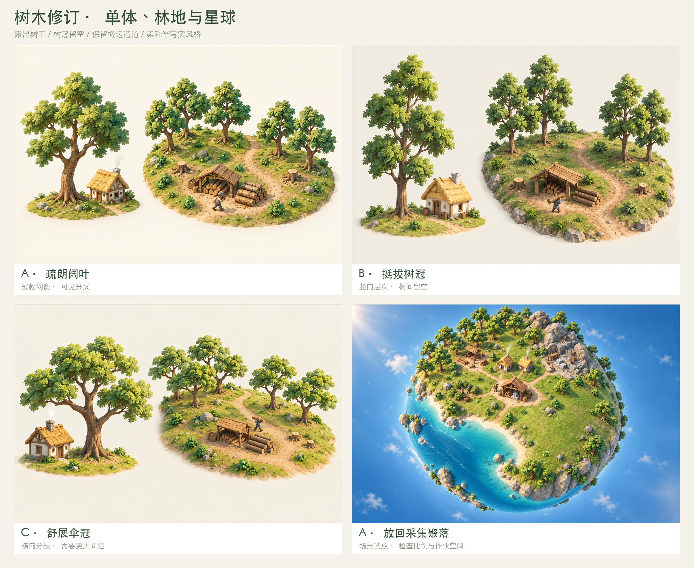

# 树木与林地修订

更新：2026-10-16 · 树木表现要求已明确，具体造型比较中

[文档索引](README.md) · [美术规范](planet-art-direction.md) · [采集聚落基准](gathering-settlement.md)

## 本轮要解决的问题

现有场景中的树冠颗粒过细、树干被遮挡、树冠连续挤压，林地容易呈现覆盖地面的团块感。用户同意先设计单棵树和一小片林地，再放回星球检查整体效果。

修订继续采用柔和半写实的微缩沙盘风格。树木需要有清楚的单体结构，也需要帮助玩家辨认伐木作业、树桩与搬运通道。

## 树木造型要求

- 用少量较大的不规则叶簇组织树冠，建议先以三至五个主要体块探索轮廓。
- 露出树干下段和主要分叉，让树木与低矮灌木具有清楚的区别。
- 叶片细节服务于体积和光照，避免密集颗粒把树冠表现成苔藓团。
- 树冠保留自然的不对称与空隙，避免规则球体、圆柱或整齐重复的盆景造型。
- 单棵树研究图加入住宅作为尺度参照，树与住宅的相对大小需要一致。
- 树干在星球上垂直于脚下地面，沿不同位置自然向外生长。

本轮探索的尺度和叶簇数量属于造型参数，最终比例需结合远景可读性与后续模型验证。

## 三种候选方向

| 方案 | 原图 | 造型重点 | 重点检查 |
| --- | --- | --- | --- |
| A · 疏朗阔叶 | [查看](assets/vegetation-studies/A-open-broadleaf.png) | 适中的冠幅、不对称叶簇与可见分叉 | 是否适合作为通用资源树，成组后是否仍可分辨 |
| B · 挺拔树冠 | [查看](assets/vegetation-studies/B-upright-crown.png) | 较窄的冠幅、竖向层次与明确树干 | 林间空隙是否清楚，是否过于整齐重复 |
| C · 舒展伞冠 | [查看](assets/vegetation-studies/C-spreading-crown.png) | 横向舒展的分枝与透气树冠 | 冠幅是否遮挡设施，是否需要过大的种植间距 |

每张研究图同时展示单棵树与小片林地。林地中的作业棚、树桩和原木堆用于说明采集功能，住宅仅作为单体尺度参照。

单体研究图重点检查枝干与树冠结构；实际放入星球后的尺寸关系以场景试放继续收敛。

## 林地组织要求

林地保留连续的资源范围，树冠之间留出空隙。树木按小组分布，组与组之间能够看见地面和通行路径，避免形成整片遮住树干的树冠顶棚。

靠近伐木点的树木需要更清楚的作业空间：可辨认的树干、少量树桩、原木堆，以及通向中央储物点的道路。低矮灌木应零散分布，不能再次填满已经留出的空隙。

树高、冠幅和朝向可以有适度变化，但应保持同一类资源树的识别特征。树木数量首先服务于可读性，画面中的实例数量不直接规定资源总储量。

## 放回采集聚落检查

[场景试放](assets/vegetation-studies/settlement-preview.png) · [前后对比](assets/vegetation-studies/settlement-comparison.jpg)

本轮使用 **A · 疏朗阔叶** 进行场景试放，检查树木与既有建筑的比例、林缘空隙和球面朝向。它是树木修订候选，具体采用哪一种造型仍需结合对比图确定。

从试放图看，林间地面和单棵树干比现有基准更清楚，伐木点周围留出了作业空间。A 的冠幅较均衡，建议优先作为通用资源树继续细化；B 与 C 保留为轮廓对照，暂不确定为额外树种系统。

核对要求：

1. 中央储物点、两座住宅、伐木点、采石场和采食区仍能辨认。
2. 道路、岩丘、海湾与主要建设空地维持原有功能关系。
3. 林缘能看见树干、树桩和通道，树木不会形成覆盖整个山坡的连续团块。
4. 从完整星球的观察距离看，仍能识别单棵树与作业点。
5. 减少冠层细节后，场景仍具有自然植被和柔和光照的气质。

当前采集聚落基准与多视角图仍记录原有场景布局。其树木细节属于待修订部分，后续确认造型后再统一各阶段和多视角的植被。

本轮交付为静态设计图，不包含可采伐模型、树木动画或新的游戏系统。
